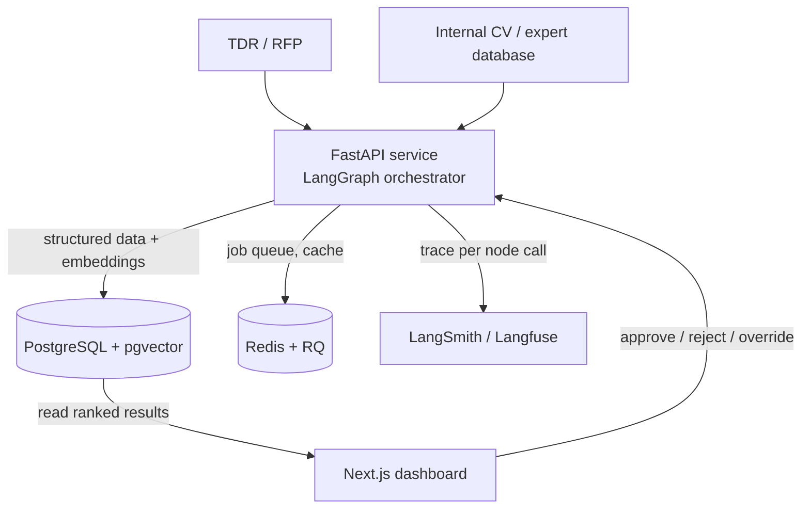
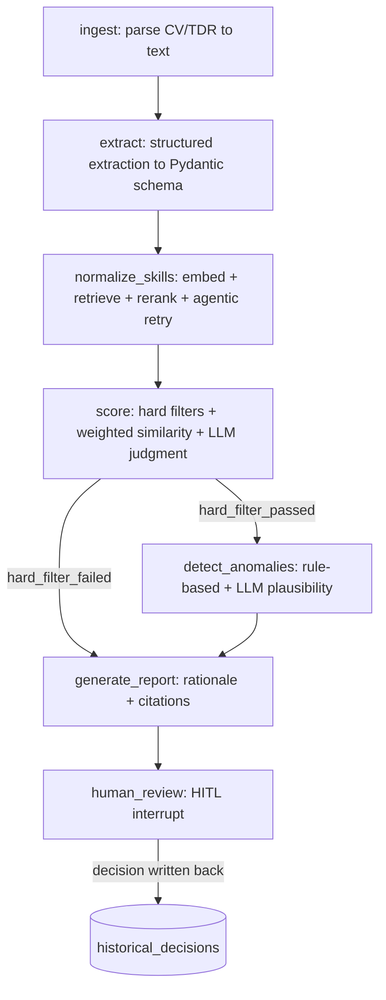

<div align="center">
  
  <h1>AdéquIA <sup><sub>v0.1.0</sub></sup></h1>
  <p><em>Le bon profil, pour la bonne mission.</em></p>
  <br/>

  
  
  
  
</div>

---

## Contents

- [Pitch](#pitch)
- [How It Works](#how-it-works)
- [Tech Stack](#tech-stack)
- [Getting Started](#getting-started)
- [Configuration](#configuration)
- [API](#api)
- [Roadmap](#roadmap)
- [License](#license)

---

## Pitch

A consulting firm bidding on a tender has to answer one question fast: which of our own experts actually fit the roles this TDR asks for? Today that question gets answered by someone reading the TDR and trying to recall or search the CV pool by hand — slow, and wrong in both directions, since a missed good match costs a winnable bid and a missed disqualifying gap risks committing unqualified staff.

AdéquIA takes a parsed TDR and the internal CV database and produces, per required position, a ranked shortlist with a compatibility score, a per-criterion breakdown, flagged anomalies, and a rationale that cites the exact source passage for every claim it makes. Extraction happens once per CV at ingestion time; matching runs per TDR position against a cheap embedding-similarity shortlist, not the full pipeline against every employee — a 25-person firm with a 3-position TDR triggers three retrieval passes and roughly 24–30 full pipeline runs, not 75.

The scoring itself is not an LLM asked to output a number. It's rule-based hard filters (mandatory diploma present, minimum years met) feeding weighted embedding similarity for soft criteria, with an LLM judgment call reserved for the genuinely qualitative parts — whether a candidate's project history matches the TDR's sector focus, for instance. An engineer reviewing this system can point to a rubric, not a black box, which matters when the output feeds a real staffing decision.

This is an HR decision-support tool, not a chatbot. The dashboard is where a reviewer approves, rejects, or overrides a ranking, and every override becomes calibration signal for future scoring.

---

## How It Works

### System topology



### Matching pipeline (per TDR position, against a shortlist)



Extraction is a separate, once-per-document ingestion pipeline (`ingest` → `extract` → embed) — it never re-runs per TDR. The diagram above is the second, per-position pipeline that runs only against the shortlist a coarse retrieval pass produces.

### Key decisions

- **LangGraph over a plain chain or a generic agent loop**: the pipeline needs a hard-filter short-circuit and a deterministic per-candidate audit trail — "why was this person ranked #3" has to be answerable from a checkpoint, not reconstructed by re-prompting.
- **Hybrid scoring over asking an LLM for a score**: pure LLM scoring is non-deterministic, which is a liability when the product's value proposition is reducing human error. Hard filters plus weighted embedding similarity plus a narrow LLM judgment step gives a rubric a reviewer can actually audit.
- **PostgreSQL + pgvector over a separate vector database**: one piece of infrastructure for a solo one-month build, and it lets a single query join structured TDR criteria with embedding similarity (`similarity > X AND certification not expired AND years_experience >= Y`) — a pure vector DB can't do that join as cleanly.
- **Two-phase matching over running the full graph per CV**: CV extraction happens once at ingestion; per TDR position, a cheap embedding + structured pre-filter (no LLM calls) shortlists ~8–10 candidates before the expensive scoring/anomaly/report pipeline runs on them.
- **TDR section localization before extraction, not full-document extraction**: real TDRs run 20–100+ pages of mostly administrative boilerplate. Chunking the document and retrieving only the sections closest to "profils/qualifications/personnel requis" keeps token cost down and avoids needle-in-haystack degradation over long context.

---

## Tech Stack

| Technology | Role | Why |
|---|---|---|
| FastAPI | Backend API, LangGraph host | Sits directly in the LangChain/LangGraph ecosystem; the eval harness (RAGAS/DeepEval) is Python-native |
| LangGraph | Pipeline orchestration | Explicit branching and a checkpointed audit trail, over a plain chain or agent loop |
| PostgreSQL + pgvector | Structured data + embeddings | One database instead of two; joins structured filters with vector similarity in a single query |
| Redis + RQ | Background job queue, cache | Keeps CV/TDR batch processing off the request path; doubles as an embedding/taxonomy cache |
| Next.js | HR dashboard | — |
| shadcn/ui | Dashboard components | — |
| Framer Motion | Dashboard transitions | — |
| LangSmith / Langfuse | Tracing | Full per-node trace of a candidate's path through the graph, tagged by TDR/position |
| RAGAS / DeepEval | Eval harness | Faithfulness/groundedness metrics on the RAG portion, wired into a CI regression gate |

---

## Getting Started

### Prerequisites
- Python ≥ 3.12
- [uv](https://docs.astral.sh/uv/)
- Node.js ≥ 20
- pnpm ≥ 9
- Docker (for local Postgres/Redis)

### Clone
```bash
git clone https://github.com/[user]/adequia.git
cd adequia
```

### Backend
```bash
cd backend
cp .env.example .env
uv sync
```

### Frontend
```bash
cd frontend
cp .env.example .env
pnpm install
```

### Local infrastructure
```bash
docker compose up -d postgres redis
```

### Run (development)
```bash
# backend — http://localhost:8000
cd backend && uv run uvicorn app.main:app --reload

# frontend — http://localhost:3000
cd frontend && pnpm dev
```

### Run everything via Docker Compose
```bash
docker compose up -d
```

### Test
```bash
cd backend && uv run pytest
cd frontend && pnpm lint && pnpm type-check
```

---

## Configuration

### `backend/.env`

| Variable | Required | Default | Description |
|---|---|---|---|
| `DATABASE_URL` | Yes | — | Postgres connection string (pgvector-enabled) |
| `REDIS_URL` | Yes | — | Job queue + cache |
| `LLM_API_KEY` | Yes | — | Provider key for extraction and scoring/report calls |
| `LLM_EXTRACTION_MODEL` | Yes | — | Fast/cheap tier — structured extraction |
| `LLM_REASONING_MODEL` | Yes | — | Stronger tier — scoring judgment, report writing |
| `EMBEDDING_MODEL` | Yes | — | Skill taxonomy + coarse retrieval embeddings |
| `EMBEDDING_DIMENSION` | No | `1536` | Must match the embedding model and `skill_taxonomy.embedding` column |
| `LANGSMITH_API_KEY` | No | — | Tracing — omit to disable |
| `LANGSMITH_PROJECT` | No | `adequia` | Trace grouping |
| `ENVIRONMENT` | No | `development` | — |
| `LOG_LEVEL` | No | `INFO` | — |

### `frontend/.env`

| Variable | Required | Default | Description |
|---|---|---|---|
| `NEXT_PUBLIC_API_URL` | Yes | `http://localhost:8000` | Frontend → backend base URL |

---

## API

### Key Endpoints

`POST /candidates/cv` — upload/update a candidate's CV, triggers re-extraction and re-embedding for that candidate only.

`POST /tdrs` — upload a TDR, runs section-localized extraction into mission/client/sector/positions.

`POST /tdrs/{tdr_id}/match` — runs the matching pipeline for all positions on a TDR against a coarse-retrieval shortlist.

`GET /positions/{position_id}/matches` — ranked match results for one TDR position.

`GET /matches/{match_id}` — full match result including report, sub-scores, anomalies, and citations.

`POST /matches/{match_id}/review` — submit approve/reject/override; writes back to `historical_decisions`.

`GET /metrics` — current eval harness output (extraction F1, retrieval precision/recall, scoring agreement, anomaly detection, cost per CV).

---

## Roadmap

| Status | Item |
|---|---|
| ✅ | Repo scaffold — FastAPI skeleton, Next.js skeleton, Postgres/Redis via Docker Compose, CI/build/eval workflow definitions |
| 🔲 | Week 1 — document parsing, structured extraction into the Pydantic schemas, gold extraction set |
| 🔲 | Week 2 — skill taxonomy, embedding retrieval + reranking + agentic retry, hybrid scoring, LangGraph wiring |
| 🔲 | Week 3 — anomaly detection (rule-based + LLM), citation-backed report generation, RAGAS/DeepEval regression suite |
| 🔲 | Week 4 — full dashboard (candidates, TDRs, matching, reports, metrics), tracing, metrics dashboard with real numbers |
| 🔲 | Stretch — company-level capability check for the bid/no-bid decision from the firm side, once the core system is stable |

---

## License

Internal internship deliverable. No LICENSE file yet — not published for external use.

---

Built by Yassine Krichen · 2026

## Before You Publish

- [ ] Add `docs/cover.png` — generate with: "AdéquIA — a dark, precise decision-support dashboard for matching expert CVs to tender requirements. Dark UI, high contrast, professional software screenshot aesthetic. Wide banner format, 1400×600px. No people, no text overlays." Place at `docs/cover.png`.
- [ ] Add screenshots to `docs/demo/` once the dashboard pages from `docs/05-frontend-dashboard.md` exist — a Demo section belongs in this README as soon as there's something to show.
- [ ] Confirm the data confidentiality policy with the company before any real CV reaches a cloud LLM API — see `docs/08-company-data-checklist.md`.
- [ ] Pick and lock in an LLM provider/model for `LLM_EXTRACTION_MODEL` / `LLM_REASONING_MODEL` / `EMBEDDING_MODEL` — currently unset placeholders in `backend/.env.example`.
- [ ] Run `uv sync` and `pnpm install` locally to generate `uv.lock` and `pnpm-lock.yaml` — not run yet, this repo is structure-only at this stage.
- [ ] Add a LICENSE file if this ever moves beyond an internal internship deliverable.
