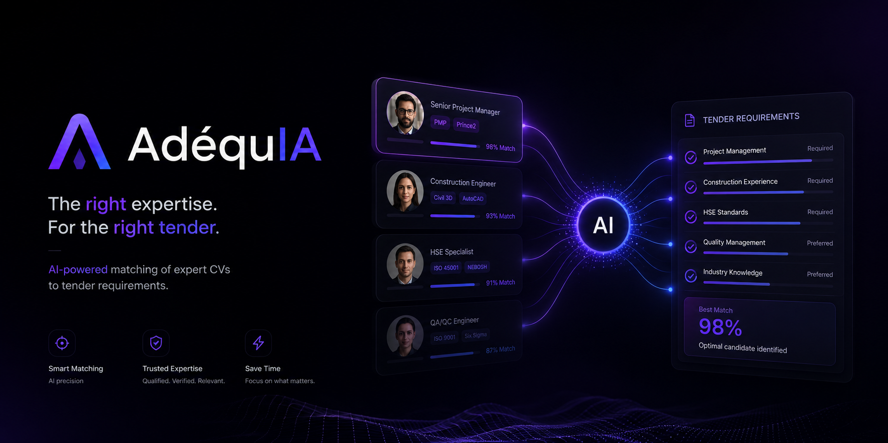
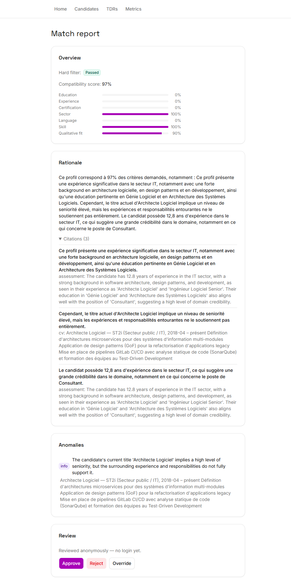
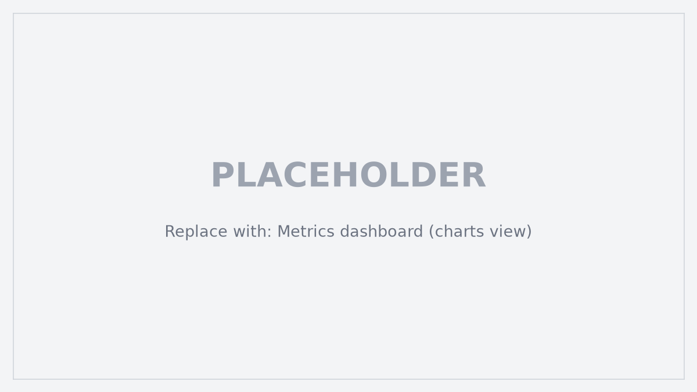
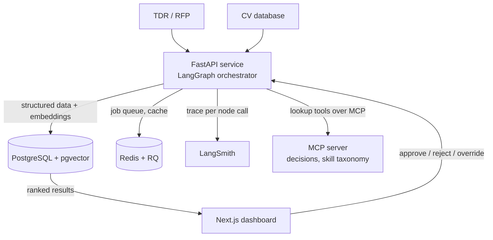
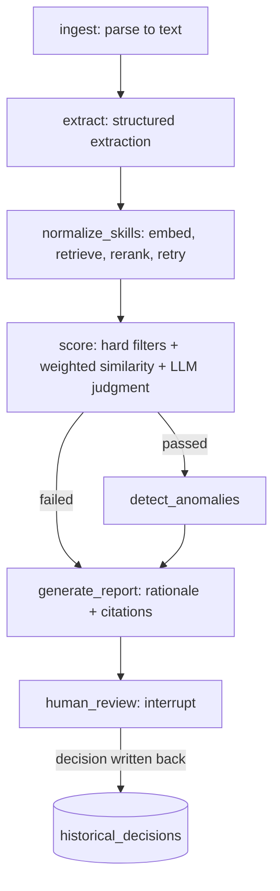

<div align="center">
  
  <h1>AdéquIA</h1>
  <p><em>Ranks internal experts against the roles in a tender, cites the source passage for every claim, and leaves the decision to a human reviewer.</em></p>
  <br/>


</div>

## Context

Built solo during my internship at ST2i (Groupe STUDI), Tunis, July to August 2026, as a decision-support prototype for tender staffing. All candidate data in this repository is synthetic; the tenders in `docs/tdrs/` are public documents from donor and government sources.

## The problem

A consulting firm answering a tender (TDR) has to decide which of its own experts fit the roles the tender asks for. Someone reads the TDR, then searches the CV pool by hand. I estimate that at 12 to 24 person-hours per tender, and it fails in both directions: a missed good match loses a winnable bid, and a missed disqualifying gap commits unqualified staff.

AdéquIA parses the TDR into positions, retrieves a shortlist from the CV pool, and produces for each position a ranked list with a compatibility score, per-criterion breakdown, flagged anomalies and a rationale whose every claim points at a source passage. Once documents are extracted, scoring a candidate against a position takes 3.52 s median (4.65 s P95).

Scoring is not an LLM asked for a number. Hard filters (mandatory diploma, minimum years) feed weighted embedding similarity, and an LLM judgment is reserved for qualitative fit such as sector relevance. A reviewer can point at a rubric rather than a black box. The dashboard is where a person approves, rejects or overrides each ranking, and that decision is written back as calibration data.

## Results

Measured by the eval suite in `backend/tests/eval/`; the committed numbers and their datasets are in [`backend/app/features/metrics/current_snapshot.json`](backend/app/features/metrics/current_snapshot.json) and explained in [`docs/04-evaluation-metrics.md`](docs/04-evaluation-metrics.md).

| Metric | Result | Dataset |
| --- | --- | --- |
| CV field extraction F1 | 0.978 | 11 synthetic CVs, 8 field types |
| TDR extraction pass rate | 12 of 13 | 13 real public TDR documents (the 13th is a scanned PDF awaiting OCR) |
| Recall@3 of the shortlist | 100% | 11 gold matching cases |
| Per-match latency | 3.52 s median, 4.65 s P95 | 28 candidate-position pairs |
| Report faithfulness | 0.91 | 11 claims judged by an LLM against their cited entries |
| Citation coverage | 100% | same set |
| Rule-based anomaly detection | precision and recall 1.0 | synthetic injection set, 4 anomaly types |
| Prompt-injection guardrails | 5 of 5 | live-LLM cases; the suite found and fixed one real vulnerability |

Limits worth stating: the gold set is small and partly hand-built, precision@3 is 0.33 by construction (one relevant candidate per position against k=3), reviewer agreement was measured on only 2 reviews, and CV and TDR extraction took minutes per document on free-tier LLMs (p50 195 s and 839 s in the efficiency run).

## Features

**Document ingestion** — Parses CV and TDR PDF/DOCX into Pydantic schemas; for 200-page TDRs it first retrieves the sections about required profiles, then extracts positions from those.

**Skill normalization** — Embeds skills, retrieves taxonomy candidates, reranks, and retries agentically when no match is found.

**Two-phase matching** — A cheap embedding and structured pre-filter shortlists candidates per position before the full pipeline runs on them.

**Explainable reports** — Each claim in the rationale carries citation IDs from a ledger built from the CV and TDR text.

**Anomaly detection** — Employment gaps, date overlaps, expired certifications and education-date inconsistencies by rule; title-seniority mismatch and unverifiable claims by LLM.

**Human-in-the-loop review** — The graph pauses at a LangGraph interrupt with a PostgreSQL checkpoint; a reviewer can resume it later from another session.

**PII masking** — Email, phone and candidate name are masked out of the outbound prompt before it reaches a cloud LLM provider.

**Provider routing** — Rotates free-tier Groq and Gemini key pools and falls back to local Ollama; every call is traced in LangSmith.

## Demo


_A match report awaiting review: hard-filter result, score breakdown, cited rationale, an anomaly, and the approve, reject or override controls._


_The metrics page, reading the eval snapshot through `GET /metrics`._

## How it works





Extraction runs once per document at ingestion. The second graph runs per TDR position, only on the shortlist.

### Key decisions

- **LangGraph over a plain chain or agent loop**: the pipeline needs a hard-filter short-circuit and a per-candidate audit trail, so "why was this person ranked third" is answered from a checkpoint instead of by re-prompting.
- **Hybrid scoring over an LLM-produced score**: pure LLM scoring is non-deterministic, which defeats a tool meant to reduce human error. Hard filters, weighted similarity and one narrow LLM step give a rubric a reviewer can audit.
- **PostgreSQL with pgvector over a separate vector database**: one piece of infrastructure for a solo build, and one query can join structured criteria with similarity (`similarity > X AND years_experience >= Y`).
- **Two-phase matching over running the graph per CV**: a 25-person pool with a 3-position TDR runs three retrieval passes and about 24 to 30 pipeline runs, not 75.
- **TDR section localization over full-document extraction**: tenders run 20 to 200 pages, mostly administrative text. Retrieving the sections closest to "required profiles" cuts token cost and avoids long-context misses.
- **Citation ledger as the only context for the rationale**: the report generator can cite only what the ledger contains, which is what makes the faithfulness number measurable.

## Tech stack

| Technology | Role | Why |
| --- | --- | --- |
| FastAPI, Python 3.12, uv | Backend API, LangGraph host | Same ecosystem as LangChain and the eval harness |
| LangGraph | Pipeline orchestration | Explicit branching, checkpointed interrupts |
| PostgreSQL + pgvector | Data and embeddings | One database instead of two |
| Redis + RQ | Job queue, cache | Keeps batch extraction off the request path |
| Ollama | Local embeddings and fallback LLM | No data leaves the machine for embeddings |
| Groq, Gemini | Cloud LLM tiers | Free-tier key pools, no paid access |
| Next.js 15, shadcn/ui | Reviewer dashboard | — |
| LangSmith | Tracing | Per-node trace of a candidate's path |
| pytest (`eval` marker) | Eval harness | Faithfulness, F1 and recall suites in the repo's own idiom, no extra dependency |

## Getting started

### Prerequisites

Python 3.12 or newer, [uv](https://docs.astral.sh/uv/), Node.js 20 or newer, pnpm 9 or newer, Docker, and Ollama with `nomic-embed-text` and `hermes3:3b` pulled.

### Run everything

```bash
git clone https://github.com/yassine-krichen/adequia-tender-expert-matching.git
cd adequia-tender-expert-matching
./scripts/dev.ps1
```

The script creates `backend/.env` and `frontend/.env` from the examples if missing, then runs `docker compose up --build` (Postgres, migrations, API, worker, frontend). Add `GROQ_API_KEYS` and `GEMINI_API_KEYS` to `backend/.env` for the cloud tiers; without them the router uses local Ollama.

- Dashboard: http://localhost:3000
- API docs: http://localhost:8000/docs

### Host-run backend and frontend

```bash
docker compose up -d postgres redis

cd backend && cp .env.example .env && uv sync
uv run alembic upgrade head
uv run uvicorn app.main:app --reload       # http://localhost:8000
uv run python -m app.worker.rq_worker      # required for TDR uploads

cd frontend && cp .env.example .env && pnpm install && pnpm dev
```

Details and gotchas: [`docs/11-sprint-1-dev-guide.md`](docs/11-sprint-1-dev-guide.md).

### Test

```bash
cd backend && uv run pytest                 # unit tests
cd backend && uv run pytest tests/eval -m eval   # live-LLM eval suites; need keys and a seeded stack
cd frontend && pnpm lint && pnpm type-check
```

## Configuration

| Variable | Required | Description |
| --- | --- | --- |
| `DATABASE_URL` | Yes | Postgres connection string (pgvector) |
| `REDIS_URL` | Yes | Job queue and cache |
| `MCP_SERVER_URL` | Yes | MCP lookup server for decisions and skill taxonomy |
| `GROQ_API_KEYS`, `GEMINI_API_KEYS` | Yes | Comma-separated free-tier key pools, rotated round-robin |
| `OLLAMA_BASE_URL` | Yes | Local fallback and embeddings |
| `GROQ_*_MODEL`, `GEMINI_*_MODEL`, `OLLAMA_*_MODEL` | Yes | Extraction and reasoning model per provider |
| `EMBEDDING_MODEL`, `EMBEDDING_DIMENSION` | Yes / No | Default 768, must match the `skill_taxonomy.embedding` column |
| `LANGSMITH_API_KEY`, `LANGSMITH_PROJECT`, `LANGSMITH_ENDPOINT` | No | Tracing; the endpoint is only for EU-region accounts |
| `PII_MASKING_ENABLED` | No | Default `true` |
| `NEXT_PUBLIC_API_URL` | Yes | Frontend to backend base URL (`frontend/.env`) |

`backend/.env.example` has the full list with defaults.

## Key endpoints

`POST /candidates/cv` — uploads a CV; re-extracts and re-embeds that candidate only.

`POST /tdrs` — uploads a TDR; returns immediately, extraction runs on the worker.

`POST /tdrs/{tdr_id}/match` — runs the matching pipeline per position on a coarse-retrieval shortlist.

`GET /matches/{match_id}` — match result with report, sub-scores, anomalies and citations.

`POST /matches/{match_id}/review` — approve, reject or override; resumes the paused graph and writes to `historical_decisions`.

`GET /metrics` — the current eval snapshot.

## Roadmap

| Status | Item |
| --- | --- |
| Done | Extraction, skill normalization, hybrid scoring, anomaly detection, cited reports |
| Done | Human-in-the-loop review with checkpointed resume |
| Done | Eval suites and metrics dashboard |
| Planned | OCR for scanned TDRs (1 of 13 fixtures fails without it) |
| Planned | Field-level F1 for TDR extraction; only the document-level pass rate is measured |
| Planned | Real historical staffing decisions as ground truth for scoring agreement |
| Planned | Authentication on the review endpoint (reviews are anonymous today) |

## License

**Source-available, not open source.** AdéquIA is published under the
[PolyForm Strict License 1.0.0](LICENSE) so you can read the code, run it, and learn
from it for personal, research, or evaluation use.

You may **not** use it commercially, redistribute it, rebrand it, or publish modified
versions without written permission. Copyright (c) 2026 Yassine Krichen. All rights
not granted by the license are reserved.

For commercial licensing or collaboration: krichenyassine22@gmail.com

Built by [Yassine Krichen](https://github.com/yassine-krichen) · Tunis, 2026
